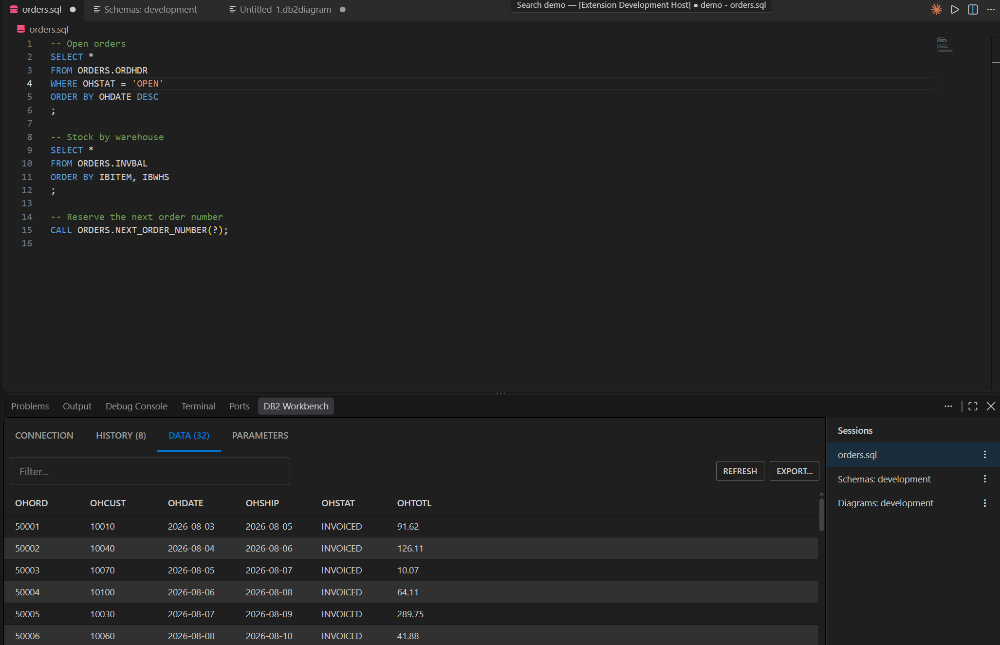
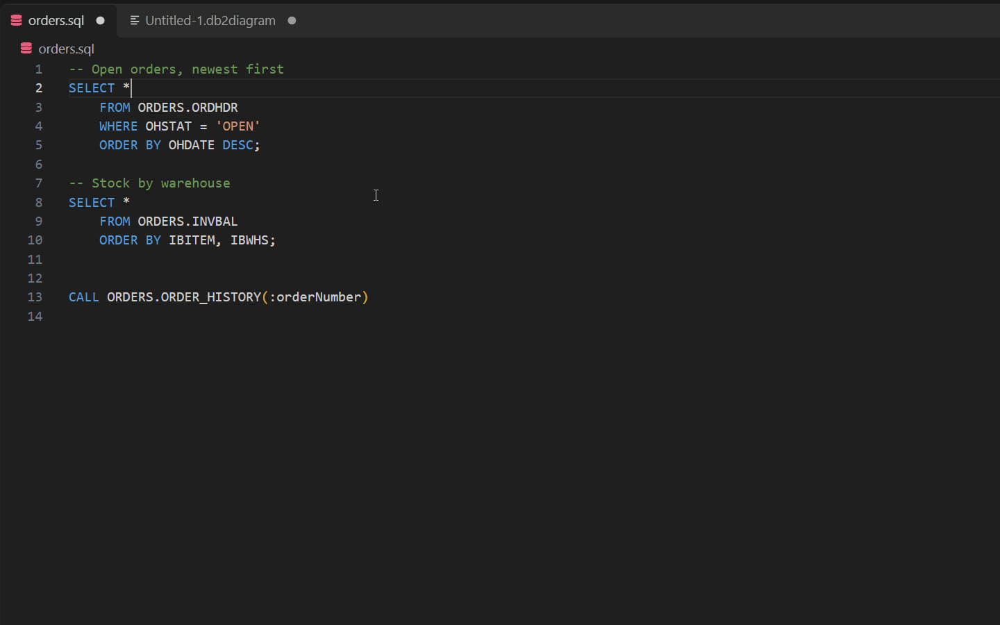
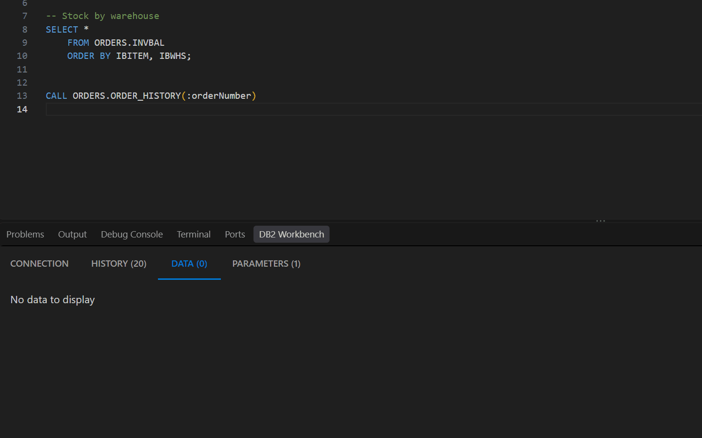
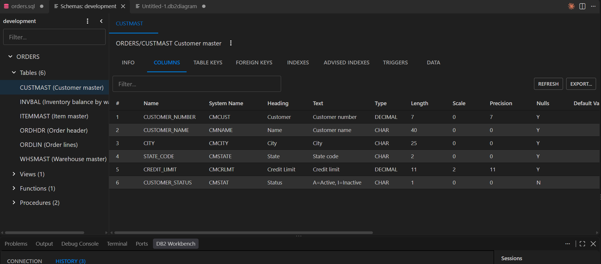
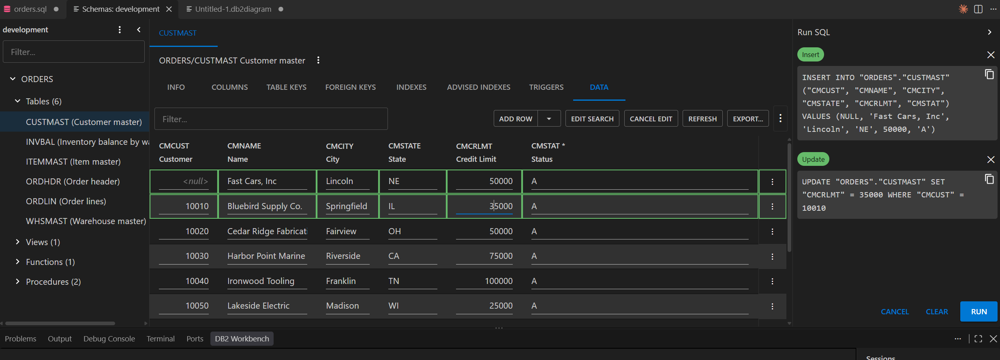
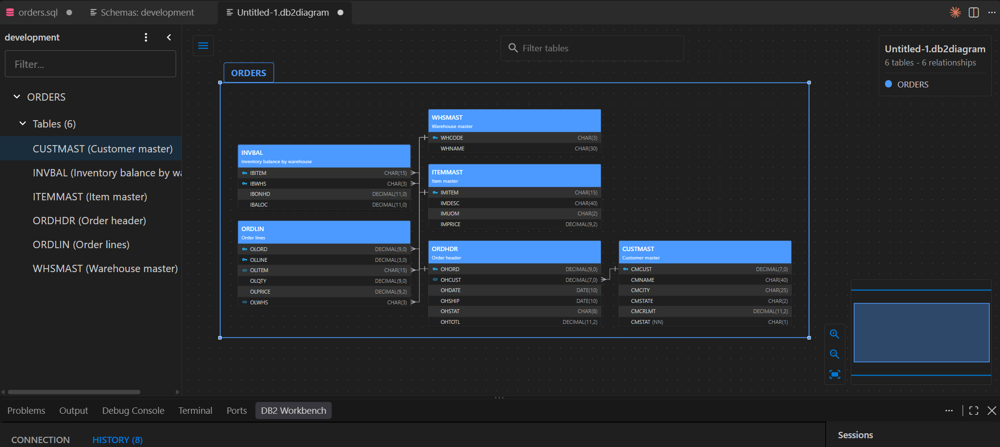
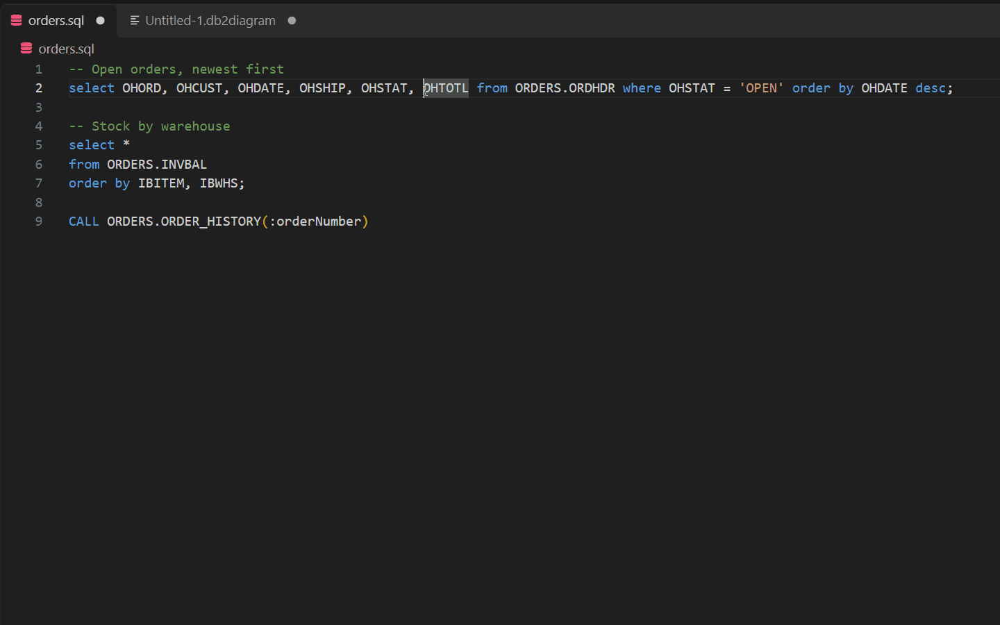

# DB2 Workbench

> **Beta.** This extension is in active development. Expect rough edges, and expect settings and file formats to change between releases.

DB2 Workbench is a VS Code extension for working with IBM DB2 for i (AS/400). Write SQL with autocomplete from your live catalog, run it and stored procedure calls over ODBC, and see the results in a panel beside your editor. On the same connections it adds a schema browser with table data editing, entity-relationship diagrams, and an SQL formatter.

## Requirements

- An ODBC driver for DB2 for i installed on your machine (the IBM i Access Client Solutions ODBC driver), and a host it can reach.
- On Linux and macOS, the unixODBC driver manager: `sudo apt install unixodbc` (Debian/Ubuntu), `sudo dnf install unixODBC` (RHEL/Fedora) or `brew install unixodbc` (macOS, Homebrew in its default location).
- Credentials for the host. You're prompted for the password on first connect. It is kept in VS Code's secret storage, never in settings.

## Getting started

1. Open **DB2 Workbench** in the activity bar and choose **Add Connection** in the Settings view.
2. Fill in the host, user name and default schema. If your environment needs one, supply a raw ODBC connection string instead.
3. Open a `.sql` file and press `Ctrl+R`. The first statement you run on a connection asks for the password.

## Features

### Autocomplete from your catalog

Schemas, tables, columns, views and functions are suggested as you type, each column with its description. Suggestions come from the live catalog and are cached per connection. `F12` (**Go to Definition**) on a table name opens it in the schema browser.

### Running SQL

| Keys | Runs |
| --- | --- |
| `Ctrl+R` | The statement under the cursor |
| `Ctrl+Shift+R` | The selected statements |
| `Ctrl+Alt+R` | Every statement in the file |

- Each open SQL file gets its own session, with its own results, connection and history. The results panel follows the active editor, or you can pick a session from the session list.
- Results are paged. The grid fetches `cursorFetchSize` rows at a time and loads more as you scroll, so a large result set never has to be read in full.
- Column headings can show the short (system) name, the long (SQL) name and the column description, in any combination (`db2-workbench.resultHeadingLabels`).
- The **History** tab keeps recent statements and connection events for the session, and **Connection** shows the job behind it.
- When the panel is too small, open the results in an editor tab or a separate window.

### Stored procedures and parameters

`CALL` statements are recognized automatically. Parameter markers (`?` or named, like `:customer`) are filled in on the **Parameters** tab, with inputs that match each parameter's type, including date and time pickers. OUT and INOUT values come back on the same tab, and result sets show in the grid.

### Schema browser

Choose **Open Schemas** on a connection to browse its schemas, tables, views, functions and procedures. Each table has tabs for:

- **Info**: the table's catalog details.
- **Columns**: names, types, lengths, nullability, headings and text.
- **Table Keys** and **Foreign Keys**: constraints and the relationships they define.
- **Indexes**: existing indexes.
- **Advised Indexes**: DB2's own index advice, with generated `CREATE INDEX` DDL you can run from the tab.
- **Triggers**: each trigger's definition, with the source of an external trigger's program.
- **Data**: browse, search and edit the table's rows.

### Editing table data

On the **Data** tab, choose **Edit Data** to add, change and delete rows in place. Every change becomes an `INSERT`, `UPDATE` or `DELETE` in the **Run SQL** panel, where you can review it, copy it, or remove it before anything runs. **Run** executes them in order and marks each one as it succeeds or fails. Required columns are enforced, NULL is set explicitly, and new rows start from per-type defaults you can change in the tab's settings.

### Diagrams

- **DB2: New Diagram** creates a `.db2diagram` file that opens in an entity-relationship editor.
- Add tables from a searchable tree, and pull in tables a relationship points to that the diagram is missing.
- Relationships come from the real foreign key constraints, drawn with crow's-foot cardinality.
- Automatic layout, filtering, an overview map, and **Sync with Database** to pick up catalog changes.
- A `.db2diagram` file is draw.io-compatible XML. Diagrams export to `.drawio`, DBML or Frictionless Table Schema, so you can open one outside VS Code or hand it to another tool.

### SQL formatting

`Ctrl+Shift+F` (**DB2: Format SQL**), or VS Code's own **Format Document** and **Format Selection**, reformats SQL to your settings: indentation, keyword case, line wrapping and clause layout. Choose **Edit Formatting** in the Settings view to adjust them with a live preview. SQL embedded in RPG or COBOL source is recognized and formatted too.

### Schema import and export

Export catalog metadata, or import extra metadata where the DB2 catalog is incomplete, for example relationships recorded in a site-specific table rather than as real constraints.

- Export to **DBML** or **Frictionless Table Schema**.
- Import from those same formats, or from **SQL**: up to three statements (tables, columns, relationships) whose result columns you map onto the fields the extension understands. Saved SQL imports live in `db2-workbench.sqlImports` and can be refreshed.
- Imported tables and columns are badged in the tree and on diagrams, so imported metadata is never mistaken for the real catalog.
- **View Imports** lists everything imported for a connection and lets you disable an import without deleting it.

## Settings

| Setting | Default | Purpose |
| --- | --- | --- |
| `db2-workbench.connections` | `[]` | The configured connections. Normally edited through the Settings view, not by hand. |
| `db2-workbench.sqlImports` | `[]` | Saved SQL schema imports and their column mappings. |
| `db2-workbench.useAlias` | `Smart` | Whether autocomplete qualifies columns with a table alias. |
| `db2-workbench.historyCount` | `20` | History entries kept per session. |
| `db2-workbench.cursorFetchSize` | `100` | Rows fetched per page. |
| `db2-workbench.sqlImportRowLimit` | `50000` | Row cap for a single SQL import statement. |
| `db2-workbench.autoFocusResults` | `true` | Focus the panel and switch to Data when a statement runs. |
| `db2-workbench.resultHeadingLabels` | `["Short Name"]` | Labels stacked in result column headings. |
| `db2-workbench.dataEdit.*` | — | Default values for new rows on the Data tab. Also editable from the tab's Settings dialog. |
| `db2-workbench.formatting.*` | — | SQL formatter options. Edit these from **Edit Formatting** in the Settings view for a live preview. |

## Contributing

See [CONTRIBUTING.md](CONTRIBUTING.md) for building, running and testing the extension. None of the test suites needs a database.

## Feedback

Report problems, wrong results or missing metadata on the [issue tracker](https://github.com/DuncanAviation/db2-workbench/issues), with the statement involved where you can. Questions are welcome in [Discussions](https://github.com/DuncanAviation/db2-workbench/discussions).

## License

[Apache License 2.0](LICENSE). The packaged extension's bundled third-party software and its licenses are listed in `THIRD_PARTY_NOTICES.txt`.
